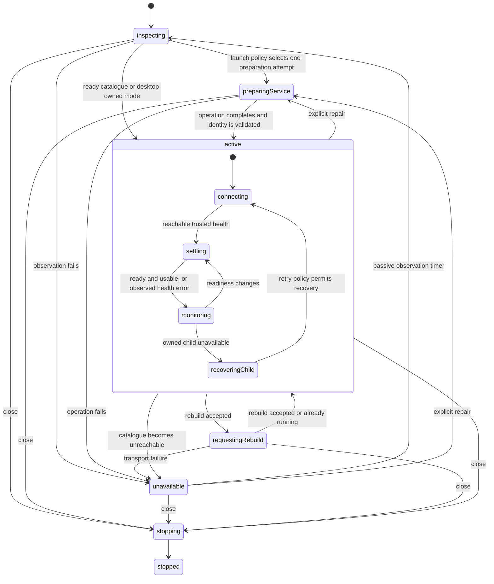

# Rescore architecture uplift

Approved design and implementation record · 14 October 2026 · Base: accf3c2 plus existing working-tree changes.

All four stages are implemented on `codex/architecture-uplift`. Existing working-tree changes were retained; nothing was committed or pushed. Initial delivery did not deploy the Windows service; a subsequently authorized installed-acceptance run is recorded below.

## Settled decisions

| Area | Selected design |
| --- | --- |
| Catalogue caches | Private caches keyed by SQLite connection; existing catalogue query interface remains. |
| Library and taste | One instance-owned main-process workflow module owns writes, imports, catalogue identity, and taste invalidation. Existing ranking calculations remain separate. |
| Renderer results | Separate Search and For You result modules; share request-lifetime implementation only where behavior is identical. |
| Runtime | An event-driven state machine coordinates catalogue runtime, Windows service preparation/repair, and application startup. |
| Library dependency | XState 5.33.2, pinned in the desktop main process only. |
| Startup | Allow one automatic launch-time preparation attempt when current launch policy requires it. Healthy running catalogues keep the fast path. After failure, monitor without repeating privileged maintenance automatically. |
| Initial unavailability | Keep inspecting valid configuration and health; connect automatically when the catalogue becomes healthy. Never spawn a second catalogue when Windows owns it. |
| Close during maintenance | Allow closure after existing draft protection and bounded desktop cleanup. Already-started elevated maintenance can finish independently. |
| Rebuild during maintenance | Reject as busy with an actionable error. Do not queue it. |

## Files and caller seams

The implementation retains the existing packages and storage layout.

| Module | Main files | What callers/tests use |
| --- | --- | --- |
| Catalogue query cache | `apps/api/src/catalog/query.ts`, a private `query-cache.ts` if separation helps, `database.ts`, `rebuild.ts` | Existing `CatalogDatabase` query/write methods. No public cache protocol. |
| Library/taste workflow | `apps/desktop/src/main/library-taste.ts`, `library-taste.test.ts`, `ipc.ts`, `catalog-client.ts` | Library operations, parsed-row import with progress, Discover/For You/profile/enrichment operations. Cache ownership and ordering remain internal. |
| Search results | `apps/desktop/src/renderer/src/lib/discover-results.ts`, its tests, and `views/Discover.tsx` | Result snapshot, filter/revision updates, refresh, load-more, and disposal. |
| For You results | `apps/desktop/src/renderer/src/lib/for-you-results.ts`, its tests, and `views/ForYou.tsx` | Result snapshot, revision/mode updates, refresh, and disposal. |
| Lifecycle machine | `apps/desktop/src/main/catalog-lifecycle.ts`, its tests, `catalog-runtime.ts`, `background-service.ts`, `index.ts`, `ipc.ts` | Main-process startup/reconnect/repair/rebuild/stop commands and existing catalogue/service status projections. XState remains an internal implementation. |

The native adapter keeps direct operating-system effects. It does not call back into the lifecycle machine to restart work.

## 1. Catalogue query cache module

### Interface and ownership

Keep `CatalogDatabase.listTitles`, `facets`, and the current write methods as the caller/test seam. Internally, use a module-private `WeakMap<Database.Database, QueryCache>`; do not key by path, revision alone, or process-global values.

The implementation owns each connection's facets value, expiry, and count map. Query and rebuild functions already receive the connection, so invalidation can use the same identity without a second parameter threaded through the codebase. Forget the cache explicitly when closing a connection; a reopened connection starts clean.

Absorb `facets-cache.ts` into this query-cache ownership. Remove its exported read/write/clear protocol once callers have migrated. Keep SQLite as the real adapter; no generic repository or substitute catalogue implementation.

### Behavior and invalidation

Preserve the existing ten-minute lazy facets TTL, count-key semantics, cursor behavior, optional counted totals, and unknown-total rules. Do not add bounded eviction in this pass: the current optional-total path can reuse a counted value, so eviction can affect observable responses.

Audit writes by what they change:

- Title insertion/removal, title attributes, genres, and ingest completion/abort invalidate affected counts and facets.
- Ratings, credits, Library visibility, and language updates invalidate affected counts.
- A failed ingest can retain already-upserted rows; facets must reflect those retained rows.
- Hydration that changes languages must invalidate counts for language-filtered queries.
- Bulk title/credits windows remain separate and retain their existing batching behavior.

Conservative per-connection invalidation is acceptable initially. The important property is correctness and locality, not maximum cache retention.

### Verification

Through the existing `CatalogDatabase` interface, interleave two catalogues with identical revisions/filters and different rows; assert independent facets and totals. Mutate one catalogue and verify both remain correct. Cover language hydration, partial-ingest abort, close/reopen, and the existing cursor/unknown-total cases.

## 2. Library and taste workflow module

### Caller interface

Introduce an Electron-free, instance-owned workflow in `apps/desktop/src/main`, with operations for listing/saving/removing/clearing Library entries, importing parsed ratings, Discover, For You, public profile, and movie enrichment. These operations replace orchestration currently embedded in `ipc.ts`; they do not add a second renderer interface.

Its internal adapter seam accepts the catalogue data operations and catalogue identity, ranking settings, and an import-progress callback. The production adapter uses `CatalogClient`; controlled adapters exercise the same workflow interface in tests.

IPC registration, trusted-sender validation, native dialogs, file selection/read/write, and progress delivery to the window remain adapters. The CSV parser remains responsible for parsing and date normalization; the workflow owns the import loop and write ordering.

### Hidden implementation

- Own catalogue client identity and the taste-cache generation together.
- Capture one catalogue identity/client per operation. A completion from an obsolete identity must not publish a result for the newly selected catalogue.
- Every write, including each successful/failed imported-row attempt, follows the existing invalidation rule; in-flight invalidated reads cannot restore old taste.
- Preserve full-Library returns for desktop save/remove and the empty result after clear. The catalogue process continues returning affected rows internally.
- Retain parsed rating dates, unscored Watched behavior, status-only update semantics, and Undo behavior.
- Reuse existing pure ranking and `loadDiscoverSlice` implementation: three ratings unlock personal ranking; page size remains 40.
- Preserve For You's response-derived Library/facets/candidates context. Do not silently replace that context with a separately cached snapshot. Preserve the current freshness of profile/enrichment reads.
- Centralize Library DTO conversion used by the client and For You. Keep the established `movieFromTitle` mapping.

Unused AppStore Library/IMDb-ID methods are optional follow-up cleanup; do not delete legacy persisted data or migrate storage as part of this refactor.

### Verification

Test edit/import → invalidation → ranked read through the workflow interface. Cover overlapping reads and writes, imported dates, partial import errors/progress totals, catalogue identity changes, under-three-rating behavior, and For You context consistency. Retain focused ranking/cache tests that still cover real internal behavior; replace tests only when equivalent behavioral coverage exists.

## 3. Renderer result modules

### Interfaces

A Search result module accepts filters, ranking mode, Library revision/statuses, and a discover-request adapter. It owns replace, append, refresh-preserving-depth, latest-result acceptance, cursor storage, load state, and immediate Library exclusions. It publishes a result snapshot and small user-intent operations such as refresh/load-more/dispose.

A separate For You result module accepts ranking mode, Library revision/statuses, and its request adapter. It owns refresh, latest-result acceptance, load state, and immediate exclusions. It has no Search cursor protocol.

Views keep rendering, selection, scrolling, layout/animation, and DOM observation. Request modules use `window.api` through production adapters; tests use controlled delayed adapters. Share a small request-generation mechanism only if the two actual implementations justify it.

### Behavior

Preserve debounce, existing loaded-depth refresh, selection, scroll, Undo visibility, stale-response rejection, and disposal. Keep `loadDiscoverSlice` as the main-process owner of page size, query/cursor rules, page ranking, and `canLoadMore`; renderer modules consume those results rather than defining paging policy again.

Visible-media observation/fill behavior stays with `useVisibleMedia`, including the IntersectionObserver and the existing hydration coordinator. This is not a new renderer data-framework migration.

### Verification

Use deferred requests to verify filter A → B, edits/Undo during refresh, append versus replace, unmount/dispose, ignored late responses, and retained result depth. Keep isolated browser checks for selection, scroll, keyboard interaction, and real view wiring.

## 4. Catalogue lifecycle machine

### Implementation choice

Use XState 5 to implement the event-driven machine in the desktop main process. A parent machine owns lifecycle sequencing; child actors handle service inspection/maintenance, connection/health work, desktop-owned process work, and the hydration stream. These are internal seams, not a new cross-process framework.

The existing renderer/preload IPC contract remains. A small main-process facade translates startup, reconnect, explicit service Retry/repair, rebuild, shutdown, and status reads into machine commands and projected results. The machine is the sole owner of operation admission and sequencing; status results expose existing DTOs, not actor internals.

### State shape

This is a schematic, not the complete transition table. Guards preserve ownership, trusted identity, port safeguards, retry limits, and health semantics. `CatalogStatus.phase` is a projection separate from machine lifecycle: a monitored error can recover, and metadata hydration does not decide browsing readiness.

### Events and effects

Commands: app start, reconnect/retry, explicit service repair, rebuild, stop, status observation.

Results: service facts, maintenance completion/failure, health/port result, child launch/exit, timer elapsed, rebuild response, shutdown completion, hydration update/disconnect. Associate asynchronous work with operation/connection/child identity; obsolete completions cannot publish or start replacement work.

Use invoked actors for asynchronous work and callback actors for streams/process events. Pass abort signals to cancellable transport work. Stopping an actor only discards its result unless its underlying effect supports cancellation; it must never be treated as Windows maintenance rollback.

### Sequencing owned by the machine

1. Inspect validated installation/configuration and current service facts.
2. On launch, use existing launch policy and allow at most one required preparation attempt per application session. Consume that allowance when automatic preparation is admitted, including UAC cancellation or failure, before invoking the adapter. Reconnects, passive observation, and repeated start commands do not reset this allowance. Explicit user repair remains separate. A healthy running service skips maintenance.
3. For admitted preparation/repair, block catalogue access, publish preparation, and quiesce desktop runtime work.
4. Invoke one Windows maintenance operation. Coalesce identical requests; preserve explicit repair intent that arrives during inspection. A request joining already-running maintenance does not start another operation. If a launch attempt fails, any new repair requires a fresh explicit user command. Reject rebuild while maintenance is active.
5. Reload durable Windows facts and validate authenticated health before reconnecting.
6. Start one monitoring/stream lifetime. After initial failure, keep observing configuration/health without automatically repeating maintenance. Passive observation must refresh registration/configuration so external recovery can unblock a previously blocked connection.
7. On close, prevent new work, stop desktop observation/streams, and stop only a desktop-owned catalogue child. The shared Windows catalogue continues.

Remove `BackgroundService.attach()` and runtime back-calls. Eliminate the duplicate starts currently issued by BackgroundService completion, app startup, and catalogue Retry.

### Windows adapter and durable state

The Windows adapter reads validated registration/configuration/SCM facts, observes maintenance activity, runs one maintenance command, returns completion/results, and opens logs. Native launch quoting, requesting-user path checks, GUI elevation, redirects/authentication, timeout/result validation, and privileged script behavior remain intact.

Keep `installation.json`, `rollback.json`, staged database copies, and `management.lock` authoritative for durable Windows recovery. Do not persist the actor snapshot as a competing recovery journal or replay privileged commands after app restart. A lock file's existence alone does not mean an operation is active.

Maintenance activity is an explicit adapter result: idle, busy, or unknown. A read-only lock-sharing probe can distinguish an exclusively held management lock from a leftover unlocked file; access denial or an untrustworthy observation is unknown, not idle. Installation phase and SCM state alone do not establish idleness. Observe this before launch-time preparation on reopening; busy/unknown keeps passive monitoring instead of opening a new maintenance broker. Observation is not an atomic reservation: the privileged script's existing lock remains authoritative for races with setup or another app process.

An initiated elevated operation can outlive Electron. Preserve its result path until the operation is finished; defer abandoned-result cleanup to a later verified cleanup path. Reopening inspects durable Windows records and active operation facts. It does not claim that app closure cancelled the operation or launch overlapping maintenance.

IPC retains sender/frame trust checks for privileged commands. Electron retains single-instance handling, unsaved-settings close protection, and destroyed-window delivery guards. Preserve the existing bounded desktop shutdown allowance; app closure does not wait for the full maintenance timeout.

### Invariants and compatibility

- Windows-owned catalogue: never spawn a desktop replacement; only explicit repair or the one allowed launch attempt invokes maintenance.
- Preserve the existing child retry/backoff limits, connection deadlines, rebuild request semantics, and 409 handling.
- A live port is evidence against spawning a competing process. Apply that guard to startup as well as recovery.
- Every accepted health snapshot updates readiness, including a catalogue that enters building/error after previously being ready.
- Rebuild remains UI-blocking; titles/credits readiness remains distinct from TMDb lookup completion and media coverage.
- Health matching retains runtime mode, protocol version, catalogue identity, and version checks. Preserve existing HTTP response interpretation unless a separately tested correction is needed.
- All late asynchronous completions are checked against current operation identity. Stop is terminal for that app lifecycle; late maintenance completion cannot restart it.

### Verification

Use XState actors through the main-process facade with concrete controlled adapters and time. Cover healthy service fast path; one preparation attempt; unavailable startup followed by external recovery; repair intent during inspection; coalesced maintenance; busy rebuild; maintenance failure/UAC cancellation; service configuration changes; occupied ports; child restart budget; stale results; rebuild/409; hydration reconnect; shutdown during every asynchronous stage; and maintenance completion after app closure.

Replace the recovery fixture's source-path rewrites and global timer replacement once equivalent machine/adaptor coverage exists. Keep real health-identity validation in integration fixtures. Retain the non-elevated Windows lifecycle fixture and package checks. Report installed/native, elevated SCM, reboot, and cross-user acceptance separately from source/fixture checks.

## Delivery sequence and review gates

1. Catalogue cache ownership and invalidation regressions.
2. Main-process Library/taste workflow and IPC integration.
3. Separate renderer result modules and browser regression checks.
4. Runtime characterization tests, XState dependency, parent/child machines, native adapters, startup/IPC integration, and recovery/shutdown verification.

Each stage should leave a usable app and independently reviewable changes. Keep existing working-tree edits intact; do not commit or push without a separate request. No workspace or storage migration is included.

Before relying on a full baseline, investigate the test-run stall observed during this review. The last completed checks were 81 desktop tests, 46 catalogue tests, and both TypeScript checks; those results predate implementation. The full test run was incomplete and must not be presented as passing.

After each stage, run its focused behavioral tests and the appropriate workspace TypeScript checks. For delivery, run the full suites once the stall is resolved, API compilation, desktop production build, isolated browser/recovery checks, relevant non-elevated service fixture/package checks, and diff review. Real installed-service acceptance remains distinct.

## Sources

- Current source: catalogue query/database/rebuild modules; desktop IPC/client/ranking/taste-cache; Search/For You/App; catalogue runtime; BackgroundService/service-launch/index; privileged maintenance scripts.
- Existing constraints: `AGENTS.md`, `docs/windows-lifecycle.md`, and the catalogue specs under `docs/superpowers/specs`.
- [XState invoked actor lifecycle and effect semantics](https://stately.ai/docs/invoke)
- [Promise actor cancellation and abort signals](https://stately.ai/docs/promise-actors)
- [Actor testing](https://stately.ai/docs/testing)

## Implementation and verification

Catalogue query caches now belong to their SQLite connection through a private WeakMap. Title, credit, language, abort, rebuild, and close paths invalidate the appropriate cached data. The full-test stall was caused by referenced delayed ANALYZE jobs; idle optimization timers now allow process exit and skip closed databases.

`library-taste.ts` owns catalogue identity, Library operations, CSV import writes, and taste invalidation. Native dialogs and IPC remain adapters; ranking stays separate. `catalog-mapping.ts` provides one Library DTO conversion. Search and For You use separate result modules with request generations and independent refresh/paging policies.

`catalog-lifecycle.ts` owns inspection, maintenance admission, preparation, authenticated recovery, child lifetime, hydration lifetime, rebuild, and shutdown through XState. `catalog-runtime.ts` supplies native effects; `BackgroundService` supplies Windows facts and maintenance effects without calling the runtime back. The read-only lock probe distinguishes active exclusive ownership from a leftover lock file.

A fresh independent review found two important command-admission regressions: rebuild could cancel pending repair inspection and strand its callers, and observed external maintenance did not block rebuild. Both were reproduced with failing tests and fixed. Additional failing regressions established that broker timeout must respect an active worker and that closure must await cleanup already running during quiescence or hung-child termination. All five regressions pass. No review findings were deferred.

Verification on 14 October 2026:

- API: 120 tests pass; desktop: 104 tests pass; API and both desktop TypeScript checks pass.
- Isolated renderer: 22 UI checks pass, plus the Library/Search/For You reconciliation and selection fixture.
- Recovery: real authenticated HTTP identity validation, initial and later recovery, and one automatic preparation attempt pass without import replacements or global timer patches.
- Native Electron adapter: authenticated health, rebuild HTTP 409 handling, outage/recovery, actual hydration delivery, stream closure, and shutdown pass with temporary user data and an isolated catalogue fixture (three streams opened, zero left active after shutdown).
- Non-elevated Windows service/installer/maintenance/logging fixtures pass, including exclusive versus leftover management locks.
- Production unpacked build and its package checks pass. Scoped lint and whitespace checks pass.

These initial checks did not exercise real elevated SCM maintenance, an installed-app upgrade, reboot recovery, or cross-user acceptance. At initial delivery, no installed catalogue or service was modified and generated unpacked output was verification material.

Follow-up: the user subsequently authorized installed/elevated acceptance. See [installed lifecycle verification](../../installed-lifecycle-verification-2026-10-14.md) for that separate run, deployed fixes, and its remaining limits. It found and corrected stale service-status projection after recovery and installer process selection that killed the sibling catalogue runtime. The desktop suite now contains 105 passing tests; native NSIS process-selection regression coverage was added to the Windows fixture suite.

The task ledger remains under `.superpowers/sdd/architecture-uplift/` because its changes are deliberately uncommitted. Integration is left to a separate user request.
